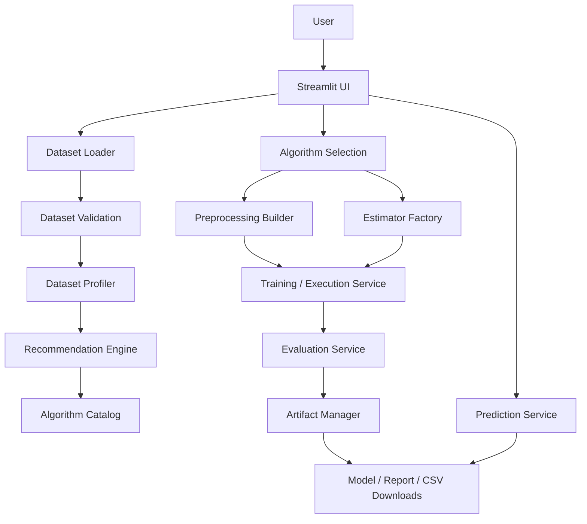

# System Architecture

## 1. Runtime flow



## 2. Module responsibilities

| Module | Responsibility | Important contract |
|---|---|---|
| `ui/dashboard.py` | User interaction and presentation | Calls application services; does not contain estimator definitions |
| `data/loader.py` | CSV/XLSX parsing and schema checks | Returns a validated `pandas.DataFrame` |
| `data/profiler.py` | Shape, types, missingness, duplicates, cardinality | Returns `DatasetProfile` |
| `recommendations/engine.py` | Explainable ranking of candidate algorithms | Returns `Recommendation` objects with reasons and caveats |
| `algorithms/catalog.py` | Single source of truth for supported model IDs | Maps stable IDs to task, family, name, and description |
| `algorithms/factory.py` | Creates fresh scikit-learn estimators | Does not load or mutate datasets |
| `preprocessing/pipeline.py` | Imputation, scaling, categorical encoding | Returns a scikit-learn `ColumnTransformer` |
| `training/trainer.py` | Split, fit, execute unsupervised methods, predict | Returns `TrainingResult` |
| `training/comparison.py` | Cross-validation candidate comparison | Uses only the training partition for CV ranking |
| `evaluation/metrics.py` | Computes task-specific metrics | Returns serializable metric dictionaries |
| `artifacts/manager.py` | Persists models and reports | Writes `.joblib` and `.json` files under `artifacts/` |

## 3. Data contracts

### Dataset

The application uses a `pandas.DataFrame` as the common tabular data contract. The target column is passed separately for supervised tasks and excluded from the feature matrix. User-selected exclusion columns are removed before the preprocessing pipeline is created.

### Supervised training

```text
DataFrame
  -> remove rows with missing target
  -> separate X and y
  -> train/test split (stratified for classification when feasible)
  -> Pipeline(ColumnTransformer, estimator)
  -> fit on train only
  -> predict test
  -> compute metrics
  -> export fitted Pipeline and test predictions
```

Imputation, scaling, and encoding live inside the estimator pipeline. Therefore, cross-validation refits preprocessing independently within each fold and avoids fitting imputation/scaling statistics on the held-out test rows.

### Unsupervised execution

```text
DataFrame
  -> remove excluded columns
  -> fit preprocessing on the provided observations
  -> fit clustering / decomposition / anomaly detector
  -> compute available internal metrics
  -> export estimator bundle and transformed output/labels
```

Unsupervised metrics are not ground-truth measures. Silhouette score is only reported when its mathematical conditions are met. Anomaly counts are not evidence that detected rows are truly anomalous.

## 4. Extension points

### Add a classical scikit-learn model

1. Add an `AlgorithmInfo` record in `algorithms/catalog.py` with a new stable ID and task.
2. Add a lazy estimator constructor in `algorithms/factory.py`.
3. Decide whether the model needs special feature constraints (non-negative, binary, sparse, etc.) and implement the corresponding preprocessing rule in `preprocessing/pipeline.py`.
4. Add it to the recommendation candidate list only when there is a defensible reason to recommend it.
5. Add tests for the expected task, input requirements, and output metrics.

### Add a new modality

Do not route image tensors, token sequences, audio, or ordered time windows through the current generic tabular preprocessor. Create modality-specific ingestion contracts and preprocessing/training packages, for example:

```text
ml_workbench/
  modalities/
    tabular/
    image/
    text/
    time_series/
  deep_learning/
    pytorch/
    tensorflow/
```

Each modality should own its dataset validation, preprocessing, model interfaces, batching, evaluation, and serialization behavior. Reuse the UI and artifact interfaces only where the contracts genuinely match.

## 5. Important design limits

- The current recommendation engine is rule-based and explainable, not a trained meta-learning system.
- Random train/test split is not valid for every dataset. Time-series forecasting requires chronological splits; repeated-subject or repeated-entity datasets may require group-based splits.
- A high-cardinality categorical column can create a large one-hot encoded matrix. Review cardinality and memory before fitting.
- No automatic leakage detection, causal validation, class rebalancing, or hyperparameter optimization is claimed by this prototype.
- This is a local single-user prototype. Multi-user production deployment needs authentication, authorization, job isolation, upload scanning, resource quotas, and background job execution.
